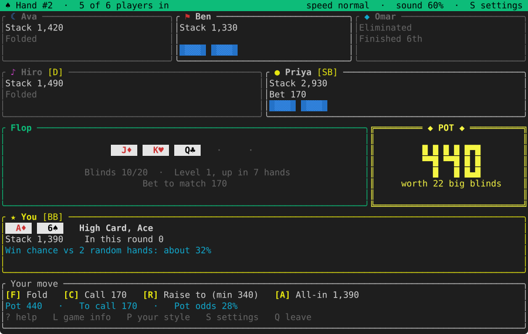

# holdem

No-limit Texas Hold'em in the terminal, written in Rust with [ratatui](https://ratatui.rs).
Play against computer opponents, or with other people over your home network or the internet.



## Features

- Up to eight bot opponents, each with one of eight playing styles.
- Multiplayer over your home network or the internet; tables on your network are found
  automatically.
- `holdem serve`: a table anyone can join, for a computer that stays on.
- Optional table rules: antes, straddle, rebuys, dead button, mucking, a hand limit, players
  coming and going.
- A win-chance hint and an estimate of your own playing style.
- Synthesized sound effects (or a build without any audio libraries for servers).
- Everything adjustable in `holdem.toml`, with every setting explained.

## Installing

Every release comes in two versions, for Linux, macOS and Windows. Both install a program
called `holdem`:
- **`holdem`**, the game with sound. On Linux it needs the ALSA library (`libasound2`), which
  every desktop has.
- **`holdem-server`**, the same game without sound and without any audio libraries, for
  dedicated servers. For Linux there are also static `musl` builds that run on any distribution.

`holdem --version` shows which one you have: `holdem 0.9.0 (with sound)` or
`holdem 0.9.0 (without sound)`.

The installers put the program in `~/.cargo/bin`. The archives on the
[releases page](https://github.com/earomc/holdem/releases) contain just the program, to run
from anywhere. Every archive is attested by GitHub: with the [GitHub CLI](https://cli.github.com),
`gh attestation verify <archive> --repo earomc/holdem` checks that it was built by this
repository's release workflow and not changed since.

### With sound (`holdem`), for playing

Linux and macOS:

```sh
curl --proto '=https' --tlsv1.2 -LsSf https://github.com/earomc/holdem/releases/latest/download/holdem-installer.sh | sh
```

Windows (PowerShell):

```powershell
powershell -ExecutionPolicy Bypass -c "irm https://github.com/earomc/holdem/releases/latest/download/holdem-installer.ps1 | iex"
```

### Without sound (`holdem-server`), for servers

Linux and macOS:

```sh
curl --proto '=https' --tlsv1.2 -LsSf https://github.com/earomc/holdem/releases/latest/download/holdem-server-installer.sh | sh
```

Windows (PowerShell):

```powershell
powershell -ExecutionPolicy Bypass -c "irm https://github.com/earomc/holdem/releases/latest/download/holdem-server-installer.ps1 | iex"
```

On a server, start a table with `holdem serve`; [Running a server](docs/server.md) explains
the rest.

## Quick start

```
holdem                  # the main menu: play against bots, host a game, or join one
holdem serve            # a table anyone can join, without playing yourself
holdem config write     # write holdem.toml with every setting explained
```

Press `?` in the game for the rules, the keys and a glossary of poker terms. The terminal
needs to be at least 80×23 (80×28 with six or more players).

## Documentation

- [Playing](docs/playing.md): ways to play, hosting and joining, controls, table options, your
  playing style.
- [Poker rules and terms](docs/poker.md): the rules implemented, a glossary, the bot styles.
- [Configuration](docs/configuration.md): the settings file and the command line.
- [Running a server](docs/server.md): `holdem serve`, the network, its log, running it as a
  service.
- [Contributing](CONTRIBUTING.md): building, tests, releasing, how the code is organized.
- [Changelog](CHANGELOG.md): what changed in each version.

## License

MIT, see [LICENSE](LICENSE).
